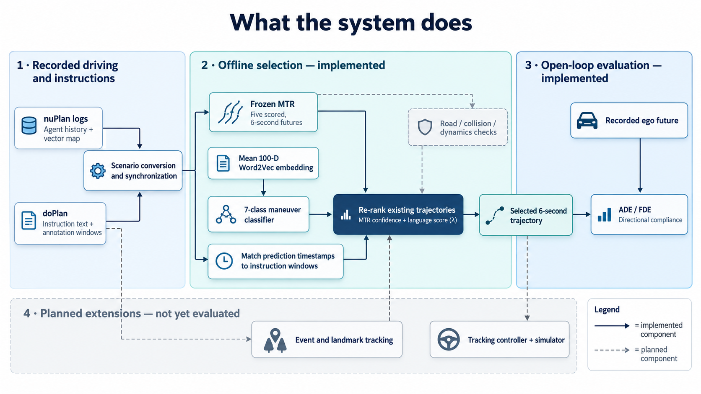

# Language-Guided Planning for Self-Driving Cars

Motion forecasting with MTR on nuPlan driving logs, and re-ranking of the predicted ego
trajectories with the passenger instructions of the doPlan dataset.

UCSD ECE 191 team project, Fall 2026. Team: Hyungjun Doh and Yushan Xian (lead).
Advisor: Prof. Mohan Trivedi. This repository holds the forecasting pipeline and the language
re-ranking module. Everything in it was built and verified on one machine: Windows with WSL2 and
Docker Desktop, NVIDIA RTX 5070 Ti.

1. [What the system does](#1-what-the-system-does)
2. [Modules](#2-modules)
3. [Repository layout](#3-repository-layout)
4. [Results so far](#4-results-so-far)
5. [Reproducing the pipeline](#5-reproducing-the-pipeline)
6. [Documentation, and what is not in the repository](#6-documentation-and-what-is-not-in-the-repository)
7. [Notes and references](#7-notes-and-references)

## 1. What the system does

A passenger says "make a left turn at the next stop sign". A motion forecaster already predicts
several plausible futures for the ego vehicle, each with a probability. This project asks whether
the instruction can pick the right one.

The forecaster is MTR (Motion Transformer) as packaged by Valeo4Cast / UniTraj, pretrained and
not retrained here. It takes 2 s of history (21 states at 10 Hz) plus the map and predicts
5 candidate trajectories ("modes") over the next 6 s (60 states), each with a score. The language
side turns an instruction into an intent distribution and re-scores the 5 modes.



*Solid boxes and arrows are implemented; dashed ones are planned. (1) nuPlan logs give agent
history and the vector map, doPlan gives instruction text with annotation windows; scenario
conversion puts both on one clock. (2) The frozen MTR produces five scored 6-second futures; the
instruction goes through a mean 100-D word2vec embedding and a 7-class manoeuvre classifier, the
prediction timestamps are matched to the instruction windows, and the existing trajectories are
re-ranked by MTR confidence plus a language score weighted by lambda. (3) The selected 6-second
trajectory is scored open-loop against the recorded ego future: ADE, FDE and directional
compliance. (4) Not yet evaluated: road, collision and dynamics checks on the candidates, event
and landmark tracking so an instruction applies only when its stop sign or light is near, and a
tracking controller in a simulator for closed-loop runs.*

The same chain in terms of the images and files of this repository:

```
nuPlan .db logs + city maps ──► nuplan-convert (CPU image) ──► ScenarioNet .pkl
                                                                     │
                                                                     ▼
                                                      mtr (GPU image): pretrained MTR
                                                                     │
                                                       5 ego modes with MTR scores
                                                                     │
doPlan instructions ──► word2vec ──► intent classifier ──► P(intent) ─┤
(text + time windows)                 turn_left / turn_right /        │
                                      lane_left / lane_right /        ▼
                                      stop / straight / other   doplan_lang (host Python):
                                                                align, gate, re-rank, evaluate
```

Three ideas carry the re-ranking:

- **Intent from text.** Skip-gram word2vec (100 dimensions) is trained on the doPlan instruction
  corpus. A logistic-regression classifier on mean word vectors maps a clause to one of seven
  intents. Labels come from keyword rules (weak supervision); the six evaluation logs are held out
  of training.
- **Geometric compatibility.** Each MTR mode is described in the ego frame by its endpoint
  lateral offset, heading change and path length. A compatibility table turns those into how well
  the mode fits each intent.
- **Decision-point gating.** The fused score is `softmax(log s_MTR + lambda * log c_intent)`,
  applied only where the plausible modes actually fork (endpoint spread over 4 m or heading spread
  over 20 degrees). Elsewhere MTR's ranking is kept. The gate exists because doPlan instructions
  refer to manoeuvres that start a median 24.6 s after they are spoken, far beyond MTR's 6 s
  horizon.

## 2. Modules

### 2.1 Software

| Module | Where | What it does |
|---|---|---|
| CUDA / PyTorch base image | `Dockerfile` (target `gpu`) | CUDA 12.8.1 + PyTorch 2.7.1 built for Blackwell (`sm_120`). `scripts/gpu_smoke.py` proves GPU access. |
| MTR image | `Dockerfile` (target `mtr`) | Valeo4Cast at a pinned commit with its KNN and attention CUDA extensions compiled for PyTorch 2.7. `scripts/patch_valeo4cast_for_nuplan.py` adds the nuPlan map types. |
| nuPlan converter image | `Dockerfile.nuplan`, `scripts/convert_nuplan.sh`, `scripts/patch_nuplan_convert.py` | nuplan-devkit (Python 3.9) plus the ScenarioNet converter, patched to work with one city map and short logs. |
| Data fetcher | `scripts/fetch_nuplan_toy.py` | Pulls single logs and maps out of the official nuPlan archives with HTTP range requests, so neither the 8.5 GB mini split nor the 150 GB train archives are downloaded whole. |
| Inference and inspection | `scripts/run_inference.sh`, `scripts/toy_nuscenes.sh`, `scripts/inspect_io.py`, `scripts/plot_prediction.py`, `scripts/check_checkpoint.py`, `scripts/check_ops.py` | Run the pretrained model, verify the checkpoint and the CUDA ops, report every input and output tensor, plot forecasts. |
| Language re-ranking | `scripts/doplan_lang/` | The doPlan side: text, word2vec, intent classifier, alignment, geometry, gate and fusion, metrics (table below). |
| Tests | `scripts/doplan_lang/tests/` | 118 pytest tests: unit tests per module (synthetic lane graph, fake predictions, box overlap) plus an end-to-end run on the toy log. |

`scripts/doplan_lang/`, in pipeline order:

| File | Role |
|---|---|
| `text.py` | Instruction normalisation, tokens, clause splitting, keyword intent rules (weak labels). |
| `train_word2vec.py` | Trains gensim skip-gram word2vec on doPlan text; writes `word2vec.kv` and a report. |
| `intent.py` | Mean-word2vec clause vectors and the logistic-regression intent classifier; 5-fold CV report. |
| `align.py` | Puts doPlan time windows and MTR predictions on the same nuPlan log clock (verified to 3 mm). |
| `geometry.py` | Per-mode ego-frame features (lateral offset, heading change, length) and intent compatibility: from lane labels (default) or from the v1 sigmoid table. |
| `rerank.py` | Decision-point gate and log-linear fusion of MTR scores with compatibility. |
| `evaluate.py` | Top-1 ADE/FDE, minADE, directional and lane compliance, counterfactual consistency, cluster-bootstrap CIs, example plots. |
| `run_all.py` | One command for the whole chain on a ScenarioNet database. |
| `embedding_space.py` | Probe of the learned embedding space (left/right axis, representative commands). |
| `scene_report.py` | Per-scene view: MTR modes from a given log timestamp onwards, before and after re-ranking (5.8). |
| `scene_paths.py` | Original (MTR top-1) vs re-ranked top-1 path at every moment where it changed, drawn on the recorded drive and the lane geometry, with the geometry of both modes (5.8). |
| `lanes.py` | Lane graph of a ScenarioNet scenario: which lane a point is on, the cheapest route between two lanes, and the manoeuvre label of a trajectory (turn, lane change, straight, stop) read off the map rather than off ego-frame thresholds (4.2, 4.3). |
| `toysim.py` | Toy simulator: pure-pursuit tracker on a kinematic bicycle executes a selected 6 s trajectory among agents replayed from the log; scores completion, collision, off-lane, comfort and tracking error (4.2, 4.3, 5.7). |
| `config.py` | Every tunable number and name in one place. |

### 2.2 Hardware and environment

- NVIDIA RTX 5070 Ti (Blackwell, compute capability 12.0). Needs CUDA 12.8 and PyTorch 2.7.1
  (cu128); the CUDA 11.8 wheels the upstream code targets do not support it.
- Windows host with WSL2 (Ubuntu) and Docker Desktop with GPU passthrough. Only the Windows NVIDIA
  driver lives on the host; all CUDA libraries are inside the images.
- The converter runs on the CPU: the six evaluation logs convert in about 1.5 min with four
  workers. MTR inference on them takes about 50 min on the GPU (12,688 ego predictions, 222k
  predictions in total).
- The language module runs on the host in plain Python (gensim 4.4, scikit-learn 1.7). It needs
  torch only to read the prediction files.

## 3. Repository layout

```
.
├── Dockerfile               # gpu and mtr image targets
├── Dockerfile.nuplan        # nuplan-convert image
├── compose.yaml             # services: nuplan-convert, gpu, mtr (mounts come from .env)
├── .env.example             # host paths for weights, data and outputs (copy to .env)
├── scripts/                 # everything the images run, plus host-side tools
│   ├── doplan_lang/         # language re-ranking package (+ tests/)
│   └── ...
├── docs/
│   ├── figures/             # system diagram (section 1)
│   └── superpowers/
│       ├── specs/...-design.md  # design document for the re-ranking (sections 1 to 9)
│       └── plans/...-rerank.md  # implementation plan with execution notes per task
└── outputs/                 # committed: metrics, reports and figures (bulk files are ignored)
    ├── doplan_lang/         # main run (lambda = 1) with plots/ and embedding_space/
    ├── doplan_lang_lam*/    # lambda sweep (0.5, 2, 4): metrics only
    ├── doplan_scenes/       # scene run of 2026-10-26 (4.3, 5.8): metrics, scenes.csv, scenes/<scene>/
    └── *_io_report.txt, *.png   # MTR input/output reports and forecast plots on the toy logs
```

Not in the repository because of size: `weights/`, `nuplan_data/`, `scenarionet_data/`, `logs/`
and the bulky parts of `outputs/`. Section 6 says how to regenerate each one.

## 4. Results so far

### 4.1 Forecasting pipeline (verified 2026-10-17)

All three images build and run. The pretrained checkpoint loads with zero missing or mismatched
tensors. On one Pittsburgh mini-split log, converted by `nuplan-convert` and predicted by `mtr`,
the first two scenarios yield 1049 prediction files covering 59 agents (vehicles, pedestrians and
one cyclist) at up to 29 prediction times each. Median minADE against the recorded futures is
about 0.5 m.


*One agent on the Pittsburgh log: observed history, recorded future (dashed) and MTR's five modes
with their probabilities.*

### 4.2 Language re-ranking (run of 2026-10-24)

Data: six doPlan-annotated nuPlan mini logs (three Singapore, three Pittsburgh), 411 scenarios,
12,688 ego predictions, 90 instructions, 77,127 (instruction, prediction) pairs. The alignment
check passed on all 411 scenarios within 3 mm. The gate is open on 82.5% of pairs. Headline
numbers are over gated pairs (63,621 pairs at 2,835 distinct moments); confidence intervals
resample moments. Compliance is measured on the 13,952 pairs whose rule-labelled instruction is
lateral and whose recorded 6 s endpoint moved at least 1 m to that side.

| lambda | top-1 ADE before | after | ADE diff 95% CI | minADE | compliance before | after | compliance diff 95% CI | counterfactual |
|---|---|---|---|---|---|---|---|---|
| 0.5 | 1.694 | 1.788 | [-0.008, +0.224] | 0.674 | 0.695 | 0.778 | [+0.045, +0.135] | 0.080 |
| 1.0 | 1.694 | 1.890 | [+0.069, +0.350] | 0.674 | 0.695 | 0.824 | [+0.080, +0.190] | 0.120 |
| 2.0 | 1.694 | 1.973 | [+0.133, +0.452] | 0.674 | 0.695 | 0.839 | [+0.092, +0.205] | 0.153 |
| 4.0 | 1.694 | 2.072 | [+0.217, +0.552] | 0.674 | 0.695 | 0.848 | [+0.097, +0.221] | 0.165 |

How to read it:

- Re-ranking makes the chosen mode follow the instructed direction more often (compliance +0.13
  at lambda 1) but moves it away from what the driver actually did (top-1 ADE +0.20 m). Both
  effects grow with lambda.
- At lambda 1 the top-1 mode changes on 14% of gated pairs. When it changes, the new mode heads
  toward the instructed side 87% of the time, yet in 47% of those moments the recorded driver was
  still going straight: the instructed turn lies later in its 30 to 500 s window. This is the
  temporal mismatch the doPlan paper reports (median 24.6 s).
- The word2vec classifier and the rules-only ablation are indistinguishable (they disagree on
  2.2% of pairs). In the embedding space `left` and `right` are each other's nearest neighbour
  (cosine 0.59). Direction is a low-variance keyword axis that the classifier still reads
  reliably: swapping left and right flips its prediction in 92.6% of turn clauses. Details in
  `outputs/doplan_lang/embedding_space/embedding_space.md`.
- 58% of the pairs come from one Singapore log with 57 annotations. Counterfactual consistency
  is low (0.12) because MTR rarely offers a mode on the opposite side.


*A typical case. The instruction says "make a left turn"; the gate is open, and fusion moves the
top-1 from MTR's straight mode (score 0.43) to the left-turn mode (0.12 to 0.88). The recorded
future (dashed) continues straight: the turn comes later in the instruction's window.*

#### Lane-grounded re-run (2026-10-27)

The scene run of section 4.3 showed that the v1 compatibility table (ego-frame lateral offset and
final heading) can credit a stopping mode as a turn and a 2 m drift as a lane change. The second
iteration (`docs/superpowers/specs/2026-10-26-lane-grounded-metric-and-toysim-design.md`) reads
what a mode does off the lane graph of the ScenarioNet scenario instead: the lane under the ego,
the lane under the endpoint, and the cheapest route between them give `turn_left`, `turn_right`,
`lane_left`, `lane_right` or `straight`; a net speed under 1 m/s over the last 0.5 s gives `stop`.
The same labels define lane compliance: among pairs where the recorded driver performs the
instructed manoeuvre within 6 s by the lane graph, the fraction whose top-1 does too. Same six
logs, same pairs and gate; the v1 table is kept as the `classifier_geometry` variant.

| gated pairs, lambda 1 | before | lane-grounded table | v1 table |
|---|---|---|---|
| top-1 ADE (63,621 pairs) | 1.694 m | 1.898 m, +0.204 [+0.063, +0.364] | 1.890 m, +0.196 [+0.069, +0.350] |
| lane compliance (6,360 pairs) | 0.686 | 0.895, +0.210 [+0.120, +0.314] | 0.849, +0.164 [+0.085, +0.255] |
| directional compliance, v1 definition (13,952 pairs) | 0.695 | 0.776, +0.081 [+0.040, +0.136] | 0.824, +0.130 [+0.080, +0.190] |

How to read it:

- The ADE cost is the same under both tables. It does not come from the geometry of the chosen
  mode but from acting on an instruction whose manoeuvre lies later in its window; a better judge
  of geometry cannot fix a timing problem.
- When the driver does perform the instruction within the horizon, the lane-grounded top-1 agrees
  with the driver's lane 90% of the time against 69% for MTR alone and 85% for the v1 table. The v1
  table scores higher on its own directional metric because that metric rewards any sideways
  drift of 1 m, which the lane graph does not count as a lane change.
- Lane labels cover 82% of (pair, mode) rows. The rest end off every lane (parking areas, the
  edge of the map window) or end travelling against the lane direction, which is a reversing
  mode and rightly has no label; such modes get the floor compatibility.
- The rules-only ablation is again indistinguishable from the classifier (lane compliance 0.901).

Toy simulator on the same gated pairs (`outputs/doplan_lang/toysim/toysim.md`): each selected
6 s trajectory is executed by a pure-pursuit tracker on a kinematic bicycle among the agents
replayed from the log, and the recorded future is executed the same way as the reference.

| execution (63,621 gated pairs) | completion within 6 s (n) | collision | off-lane | tracking RMS |
|---|---|---|---|---|
| MTR top-1 | 0.188 (57,211) | 0.092 | 0.053 | 0.24 m |
| re-ranked top-1 | 0.344 (58,868) | 0.090 | 0.051 | 0.24 m |
| recorded future (40,341 with a full future) | 0.222 (36,840) | 0.001 | 0.004 | 0.12 m |

Differences re-ranked minus MTR: completion +0.137 [+0.101, +0.173], collision -0.001 [-0.006,
+0.003], off-lane -0.002 [-0.012, +0.006]. On the 9,947 pairs where the top-1 changed, completion
goes from 0.03 to 0.99 (the label table picks a mode that performs the manoeuvre by construction)
while collisions fall from 6.9% to 6.2% and off-lane runs from 6.0% to 4.9%.

This answers the question the ADE could not. The re-ranked path is not less safe or less
drivable than MTR's own top-1: the collision and off-lane rates are the same, and the tracker
follows both to within a quarter of a metre. It performs the instructed manoeuvre within 6 s on
34% of pairs, more than the recorded driver did in the same windows (22%). So the worse ADE is the
cost of acting on the instruction earlier than the driver, not of a worse or unsafe trajectory.
Two cautions: MTR's own top-1 collides in 9% of replays against 0.1% for the recorded path,
which is what a 1.7 m ADE forecaster looks like against non-reactive agents, and the agents do
not react, so every collision after the ego leaves the recorded path is pessimistic.

Next step: event and landmark tracking ("stage tracking" in section 9 of the design document),
which applies an instruction only once the event it refers to (the stop sign, the light) is near.

### 4.3 Two Las Vegas scenes by start timestamp (run of 2026-10-26)

A teammate named scenes the way an evaluation sheet does: a nuPlan log and a start timestamp in
microseconds. This run took the two scenes they suggested starting with (Scene 1 and Scene 7 of
their list) through the whole chain: fetch, convert, MTR, re-rank, per-scene report. The commands
are in section 5.8 and the outputs in `outputs/doplan_scenes/`.

| | Scene 1 | Scene 7 |
|---|---|---|
| clip (nuPlan log) | `2021.06.09.12.39.51_veh-26_05332_05540` | `2021.07.16.21.17.55_veh-26_03772_03842` |
| start timestamp (us) | 1623262378149565 | 1626474267522457 |
| where it sits | 25.1 s into a 207.9 s log (lidar frame 502 of 4160) | 3.6 s into a 69.9 s log (frame 72 of 1400) |
| archive, log size | `nuplan-v1.1_train_vegas_2.zip` (152 GB), 126 MB member | `nuplan-v1.1_train_vegas_6.zip` (176 GB), 38 MB member |
| anchor token (frame 2 s before the start) | `7331a1b10a775a4b` (frame 462) | `3e1942159626505c` (frame 32) |
| scenario after conversion | 201 steps, 157 objects, 1324 map features | 201 steps, 95 objects, 1281 map features |
| doPlan text at the start | none: the clip's only instruction, "Merge to the right lane.", runs 85 to 205 s | 4 instructions: two "take a right", "switch into the second right most lane", "get behind the black suv" (2 more join within the 10 s) |

Both start timestamps are exact `lidar_pc` timestamps, so the scenes come from nuPlan itself,
not from doPlan frames. Both sit in the first scenes of their logs, which the devkit's scenario
query silently drops; the three converter knobs of section 5.8 were added for this run.

What ran, in order (20 min of wall clock, 17:31 to 17:51; the path comparison was added at 22:06):

| step | what happened |
|---|---|
| images | Both project images had to be rebuilt (from the build cache, a few minutes); the converter image twice more as the knobs of section 5.8 were added. |
| fetch | Both logs and the Las Vegas map (524 MB) were range-read from the public bucket, about 0.7 GB transferred. The first attempt failed at the verification step (train logs say `las_vegas` in `log.location`; the script now checks `log.map_version`, see 5.8). |
| convert | `NUPLAN_SCENARIO_TOKENS` with the two anchor tokens, `NUPLAN_DEFAULT_WINDOW=true`, `NUPLAN_INCLUDE_EDGE_SCENES=true`: 2 scenarios of 20 s. |
| MTR | 461 batches in 43 s on the GPU; 3683 prediction files, 80 of them ego (40 per scenario, every 0.5 s). |
| re-rank | `run_all` with both logs held out of word2vec and classifier training. Alignment check 2 of 2 scenarios at 0.000 m. 197 (prediction, instruction) pairs, all on Scene 7's log (Scene 1's log has one annotation, with no prediction inside its window); gate open on 91% of pairs; classifier and rule label disagree on 20%. |
| report | `scene_report`: 21 moments per scene, nearest prediction within 0 ms (Scene 1) and 4 ms (Scene 7) of the nominal moment; original-vs-changed path figures and tables (`scene_paths.py`). |

The run-level numbers (`outputs/doplan_scenes/metrics.md`) cover one log and 40 moments, so they
are an example rather than a result; the per-scene reports are the point of the run. The table
has three variants: `classifier` is the current method (lane-grounded compatibility, section
4.2 "lane-grounded re-run"), `classifier_geometry` the v1 ego-frame table, `rules_only` the
keyword labels with the lane-grounded table.

| what (gated pairs: 180, 37 moments) | before | after | diff [95% CI] |
|---|---|---|---|
| top-1 ADE, lane-grounded compatibility | 2.367 m | 2.377 m | +0.010 [-0.123, +0.146] |
| top-1 ADE, v1 geometric compatibility | 2.367 m | 2.185 m | -0.182 [-0.351, -0.046] |
| lane compliance (16 pairs where the driver did the manoeuvre within 6 s) | 0.938 | 1.000 | +0.062 [0.000, +0.231] |
| directional compliance (30 lateral pairs, v1 definition) | 0.967 | 1.000 | +0.033 [0.000, +0.120] |

- Scene 1 (`scenes/scene1/scene1.md`): no instruction window covers any of the 21 moments, so
  the gate is never consulted and the report is MTR alone. Top-1 ADE over the 10 s is 0.69 to
  2.34 m (median 1.33 m); median minADE 0.99 m. The drive is a left turn through an intersection
  and MTR's top-1 follows it (`scene1_paths.png`).
- Scene 7 (`scenes/scene7/scene7.md`): the driver is in a right turn at a stop sign and then
  slows almost to a stop some 55 m on. Six instructions touch the 10 s window (98 rows at
  21 moments, gate open on 95% of rows). With the lane-grounded table, re-ranking changes the
  top-1 on 12 rows at 12 moments, closer to the recorded path on 4 and farther on 8.


*Scene 7 on the lane geometry of its scenario: the recorded drive (black), MTR's top-1 (blue) and
the re-ranked top-1 (red) at every moment where re-ranking moved it. One panel per changed moment,
with history and recorded future, is in `scene7_changed.png`; the "Original vs re-ranked top-1
path" table in `scene7.md` gives the lane labels of both modes and of the recorded future.*

What the v1 improvement was. Under the v1 ego-frame table (first reading of this run, kept as
the `classifier_geometry` variant) the top-1 ADE fell by 0.18 m, but the path comparison showed
that most of it came from one artefact: the stopping mode creeps back 0.8 m at its end, its final
heading reads as -175 deg, and the sigmoid table credits that as a weak right turn (0.16 against a
0.02 floor), so "take a right" picked the slowest mode while the car happened to be braking. The
lane graph reads that mode as `straight` with the stop flag, or as unlabelled when it ends
reversing, and the improvement disappears: +0.01 m, CI straddling zero.

What remains under the lane-grounded table, read from the changed-moments table:

- "get behind the black suv at the stoplight" (classifier intent `stop`; the keyword rules say
  `other`) picks a stopping mode at six moments. At 0.5 to 3.5 s the driver is still in the right
  turn and the error rises (1.1 -> 3.2 m up to 0.9 -> 5.3 m); at 8.5 to 10 s the driver is braking
  and it falls (5.7 -> 3.5, 5.4 -> 0.5, 4.8 -> 1.4 m). Same instruction, right geometry, wrong
  then right timing: the temporal mismatch of section 4.2, now for a stop.
- "switch one lane to the left" at 4.5 and 6.0 s picks the lane-change mode (label `lane_left`)
  that the driver did not take within 6 s (0.7 -> 1.9, 2.4 -> 4.6 m).
- "switch into the second right most lane" no longer changes anything. By the map, the modes
  MTR offers at 4 to 6 s are `lane_left` (the 2 m drift does cross into the left lane) or
  `straight`; none is a lane change to the right, so all share the floor and the top-1 keeps
  MTR's order. The v1 table had separated them on sub-floor sigmoid differences (0.02 vs 0.03).

Toy simulator on the same pairs (`outputs/doplan_scenes/toysim/toysim.md`; gated subset, 180
executions per variant, the recorded future on the 117 pairs with a full future):

| execution | completion within 6 s (n) | collision | off-lane | tracking RMS |
|---|---|---|---|---|
| MTR top-1 | 0.122 (147) | 0.000 | 0.000 | 0.12 m |
| re-ranked top-1 | 0.143 (147) | 0.011 | 0.006 | 0.15 m |
| recorded future | 0.170 (94) | 0.000 | 0.000 | 0.06 m |

Completion is low for every execution, the recorded driver included, because most instructions
are not acted on within any given 6 s window; the re-ranked top-1 completes 2 points more
(+0.020 [0.000, +0.049]). The two collisions (1.1%) are at the start of the log, where the
re-ranked mode is a sharper right turn that cuts the corner through a pedestrian (a 1.0 by 0.8 m
box walking at 1.5 m/s); the one off-lane run is the short mode the stop instruction picks at
2.5 s, which leaves the mapped lanes inside the intersection for a third of its steps. The tracker
follows every plan to within 0.15 m. The simulator replays the logged agents, so a collision after
the ego leaves the recorded path is pessimistic; these two happen within 4 s of the start.

Follow-ups from this run: stage tracking (apply an instruction only when its stop sign or light
is near), and the rest of the teammate's scene list, with an instruction for scenes like Scene 1
where doPlan has no text at the start.

## 5. Reproducing the pipeline

### 5.0 Prerequisites (Windows + WSL2)

1. Install and start [Docker Desktop for Windows](https://docs.docker.com/desktop/features/gpu/).
2. Docker Desktop > Settings > General: enable **Use the WSL 2 based engine**.
3. Docker Desktop > Settings > Resources > WSL Integration: enable your Ubuntu distro.
4. From your WSL Ubuntu shell: `docker version && docker compose version`.
   Docker Compose **2.30 or newer** is required for `gpus: all`.
5. Confirm GPU access before building anything:

   ```bash
   docker run --rm --gpus all nvidia/cuda:12.8.1-base-ubuntu22.04 nvidia-smi
   ```

You do not need `nvcc` or PyTorch on the host. The NVIDIA display driver stays on Windows.

### 5.1 Clone and build the GPU image

```bash
git clone <this repository> ~/projects/valeo_mtr_docker
cd ~/projects/valeo_mtr_docker
cp .env.example .env
mkdir -p weights scenarionet_data outputs nuplan_data

docker compose build gpu
docker compose run --rm gpu
```

Expected: the GPU name, `CUDA True`, capability `(12, 0)` and
`SUCCESS: CUDA matrix multiply executed on the GPU.` If this fails, fix Docker Desktop's WSL 2
integration, not the MTR code.

### 5.2 Build the MTR image

```bash
docker compose build mtr
```

This fetches Valeo4Cast at commit `dce207347c140ed5cdaeac6c217eb00ee0634e71`, installs its
Python packages, applies the nuPlan loader patch and compiles its KNN and attention CUDA
extensions for `TORCH_CUDA_ARCH_LIST=12.0`. If compilation fails, keep the build log and fix the
indicated C++/CUDA API rather than downgrading PyTorch to the original CUDA 11.8 wheel, which does
not support `sm_120`.

### 5.3 Weights and data

Download `pretrained_weights.zip` from
https://drive.google.com/drive/folders/1qzHdi6wIexiyrF03pZHPzz5h1LssqeX4 and extract it into
`./weights/` (it contains `checkpoint_for_val_test.ckpt`). Alternatively set `HOST_WEIGHTS_DIR`
in `.env` to an absolute WSL path that holds the extracted checkpoint.

`.env` holds the host paths the containers mount (defaults shown):

```
HOST_WEIGHTS_DIR=./weights
HOST_SCENARIONET_DIR=./scenarionet_data
HOST_RESULTS_DIR=./outputs
HOST_NUPLAN_DIR=./nuplan_data      # raw nuPlan logs and maps for the converter
```

`run_inference.sh` reads `$SCENARIONET_DIR` (default `/mnt/scenarionet`), so several ScenarioNet
databases can live side by side under that mount.

### 5.4 Check the checkpoint

```bash
docker compose run --rm mtr bash -lc '
  CKPT=$(find /mnt/weights -name checkpoint_for_val_test.ckpt -print -quit)
  test -n "$CKPT" || { echo "checkpoint not found" >&2; exit 2; }
  python3 /opt/mtr-scripts/check_checkpoint.py "$CKPT" --compare-model'
```

Missing keys, unexpected keys and shape mismatches must all be zero. If loading fails on
trusted Lightning metadata and you trust the file, the script accepts `--unsafe-trusted-file`.

### 5.5 Run inference

```bash
docker compose run --rm mtr bash /opt/mtr-scripts/run_inference.sh
```

Predictions land in `<HOST_SCENARIONET_DIR>/output_MTR/*.pt`. `run_inference.sh` caps the run at
`debug_max_nb_scenarios=2`; extra arguments go to Hydra, for example
`bash /opt/mtr-scripts/run_inference.sh debug_max_nb_scenarios=100`.

Without any nuPlan data, `bash /opt/mtr-scripts/toy_nuscenes.sh` runs the same path on the
nuScenes samples bundled with Valeo4Cast and writes `outputs/toy_io_report.txt` (every model
input and output field with its shape) plus `outputs/toy_forecast.png`.

To open a shell in the container:

```bash
docker compose run --rm mtr bash
# inside: nvidia-smi ; python3 /opt/mtr-scripts/gpu_smoke.py
```

### 5.6 nuPlan: convert one log and predict on it

nuPlan logs are `.db` SQLite files, one per drive, plus one GeoPackage map per city.
`scripts/fetch_nuplan_toy.py` reads single members out of the official archives with HTTP range
requests:

```bash
python3 scripts/fetch_nuplan_toy.py --dest nuplan_data --list      # all 64 mini logs by size
python3 scripts/fetch_nuplan_toy.py --dest nuplan_data \
    --log 2021.08.24.13.12.55_veh-45_00386_00472 --city us-pa-pittsburgh-hazelwood
```

That transfers 149 MB (an 11 MB log and the 187 MB Pittsburgh map, compressed) into the layout
nuplan-devkit expects under `nuplan_data/` and verifies the log with SQLite. The data is
CC BY-NC-SA 4.0 plus Motional's additional terms; the LICENSE is written next to it.

Convert on the CPU, then run the pretrained model on the result:

```bash
docker compose build nuplan-convert
docker compose run --rm nuplan-convert           # -> scenarionet_data/nuplan_toy/
docker compose run --rm -e SCENARIONET_DIR=/mnt/scenarionet/nuplan_toy \
    mtr bash /opt/mtr-scripts/run_inference.sh   # -> scenarionet_data/nuplan_toy/output_MTR/
docker compose run --rm -e SCENARIONET_DIR=/mnt/scenarionet/nuplan_toy mtr bash -lc \
    'python3 /opt/mtr-scripts/inspect_io.py --cache $SCENARIONET_DIR/cache_test_MTR \
       --outputs $SCENARIONET_DIR/output_MTR --plot /mnt/outputs/nuplan_toy_forecast.png'
```

Every log under the converter's input split is converted together. `NUM_WORKERS`,
`NUPLAN_RAW_DIR` and `SCENARIONET_OUT` can be passed with `-e`.

What `Dockerfile.nuplan` works around (patches live in `scripts/patch_nuplan_convert.py`):

- nuplan-devkit pins Python 3.9 and torch 1.9, so conversion cannot share the `mtr` image.
- The devkit's map loader opens all four city maps at start-up. The patch skips cities whose
  `map.gpkg` is not on disk, so one city's map is enough.
- The vendored converter dropped every scenario without a mission goal. It never uses the goal,
  and short mini-split logs have none, so that filter now defaults off
  (`NUPLAN_REMOVE_INVALID_GOALS=true` restores upstream behaviour).
- The converter emits two map types that no metadrive release defines, so metadrive is installed
  from a pinned git commit. On the reader side, `scripts/patch_valeo4cast_for_nuplan.py` maps
  them for UniTraj: lanes through intersections count as lanes, sidewalk polygons are skipped.

### 5.7 doPlan language re-ranking

Host-side Python, no Docker needed for the language part:

```bash
python3 -m pip install -r scripts/requirements-doplan.txt
PYTHONPATH=scripts python3 -m pytest scripts/doplan_lang/tests -q        # 102 tests
```

Fetch the doPlan annotations and the six evaluation logs with their two city maps, then expose
the six logs to the converter as their own split:

```bash
mkdir -p nuplan_data/doplan
curl -sSL -o nuplan_data/doplan/release_annotationsV1.csv \
  https://raw.githubusercontent.com/Mi3-Lab/doPlan/main/outputs/doPlan_submissions/release_annotationsV1.csv

python3 scripts/fetch_nuplan_toy.py --dest nuplan_data \
  --log 2021.10.11.02.57.41_veh-50_00352_00535 \
  --log 2021.10.11.08.31.07_veh-50_01750_01948 \
  --log 2021.10.11.02.57.41_veh-50_01522_02088 \
  --log 2021.08.17.18.54.02_veh-45_00665_01065 \
  --log 2021.08.17.17.17.01_veh-45_02314_02798 \
  --log 2021.08.17.16.57.11_veh-08_01200_01636 \
  --city sg-one-north --city us-pa-pittsburgh-hazelwood

mkdir -p nuplan_data/nuplan-v1.1/splits/doplan
for l in 2021.10.11.02.57.41_veh-50_00352_00535 2021.10.11.08.31.07_veh-50_01750_01948 \
         2021.10.11.02.57.41_veh-50_01522_02088 2021.08.17.18.54.02_veh-45_00665_01065 \
         2021.08.17.17.17.01_veh-45_02314_02798 2021.08.17.16.57.11_veh-08_01200_01636; do
  ln -f nuplan_data/nuplan-v1.1/splits/mini/$l.db nuplan_data/nuplan-v1.1/splits/doplan/$l.db
done
```

Convert and predict with the Docker services, then run the language chain:

```bash
docker compose run --rm -e NUPLAN_RAW_DIR=/mnt/nuplan/nuplan-v1.1/splits/doplan \
    -e SCENARIONET_OUT=/mnt/scenarionet/nuplan_doplan -e NUM_WORKERS=4 nuplan-convert
docker compose run --rm -e SCENARIONET_DIR=/mnt/scenarionet/nuplan_doplan \
    mtr bash /opt/mtr-scripts/run_inference.sh debug_max_nb_scenarios=100000

PYTHONPATH=scripts python3 -m doplan_lang.run_all --scenarionet scenarionet_data/nuplan_doplan \
  --nuplan nuplan_data --csv nuplan_data/doplan/release_annotationsV1.csv --out outputs/doplan_lang
```

`run_all.py` accepts `--lam` for the sweep, `--no-pt` to skip writing the 910 MB of re-scored
prediction files, and `--compat geometry` to use the v1 ego-frame compatibility table for every
variant (the default is the lane-grounded table, with `classifier_geometry` written as an
ablation). The toy simulator and the embedding-space probe are separate commands:

```bash
PYTHONPATH=scripts python3 -m doplan_lang.toysim --scenarionet scenarionet_data/nuplan_doplan \
  --reranked outputs/doplan_lang/reranked.csv --out outputs/doplan_lang/toysim     # [--max-pairs N]
```

```bash
PYTHONPATH=scripts python3 -m doplan_lang.embedding_space \
  --csv nuplan_data/doplan/release_annotationsV1.csv \
  --kv outputs/doplan_lang/word2vec.kv --clf outputs/doplan_lang/intent_clf.joblib \
  --out-dir outputs/doplan_lang/embedding_space
```

Outputs in `outputs/doplan_lang/`: `word2vec.kv` and `word2vec_report.md` (616 words),
`intent_clf.joblib` and `intent_report.md` (0.957 cross-validated agreement with the keyword
rules), `pairs.csv`, `coverage.csv`, `reranked.csv` (per pair: intent probabilities, gate,
per-mode features, MTR and fused scores, errors), `reranked_rules.csv` (rules-only ablation),
`reranked_geometry.csv` (v1 compatibility ablation), `reranked_pt/` (predictions with fused scores),
`metrics.json`, `metrics.md` (ADE/FDE, directional and lane compliance), `plots/`, and from the
simulator `toysim/toysim.csv|json|md` and `toysim/plots/`.

### 5.8 Running on specific scenes (log name + start timestamp)

A scene is a nuPlan log plus a lidar timestamp in microseconds, the way a teammate or an
evaluation sheet would name it. The chain below fetches the log from the public train archives,
converts exactly one 20 s scenario per scene, runs MTR on it and reports the modes at the scene
start and every 0.5 s after it, with the doPlan instructions whose windows cover each moment.
Verified on two Las Vegas scenes on 2026-10-26; that run is documented in section 4.3 and its
outputs are in `outputs/doplan_scenes/`.

```bash
# 1. logs from the train archives (--archive picks nuplan-v1.1_<archive>.zip; only the members
#    asked for are transferred) and the city map; logs land in nuplan-v1.1/splits/<archive>/
python3 scripts/fetch_nuplan_toy.py --dest nuplan_data --archive train_vegas_2 \
    --log 2021.06.09.12.39.51_veh-26_05332_05540 --city us-nv-las-vegas-strip
python3 scripts/fetch_nuplan_toy.py --dest nuplan_data --archive train_vegas_6 \
    --log 2021.07.16.21.17.55_veh-26_03772_03842 --city us-nv-las-vegas-strip
mkdir -p nuplan_data/nuplan-v1.1/splits/scenes
ln -f nuplan_data/nuplan-v1.1/splits/train_vegas_*/2021.0*.db nuplan_data/nuplan-v1.1/splits/scenes/

# 2. one scenario per scene, anchored 2 s BEFORE the start timestamp so that MTR's first
#    prediction (it needs 2 s of history) falls on the start. The anchor is the lidar_pc token
#    of that frame: SELECT hex(token) FROM lidar_pc WHERE timestamp = <start_us - 2000000>.
docker compose run --rm -e NUPLAN_RAW_DIR=/mnt/nuplan/nuplan-v1.1/splits/scenes \
    -e SCENARIONET_OUT=/mnt/scenarionet/nuplan_scenes -e NUM_WORKERS=2 \
    -e NUPLAN_SCENARIO_TOKENS=7331a1b10a775a4b,3e1942159626505c \
    -e NUPLAN_INCLUDE_EDGE_SCENES=true -e NUPLAN_DEFAULT_WINDOW=true nuplan-convert

# 3. MTR, then the language chain with the scene logs held out of training, then the report
docker compose run --rm -e SCENARIONET_DIR=/mnt/scenarionet/nuplan_scenes \
    mtr bash /opt/mtr-scripts/run_inference.sh debug_max_nb_scenarios=100000
PYTHONPATH=scripts python3 -m doplan_lang.run_all --scenarionet scenarionet_data/nuplan_scenes \
    --nuplan nuplan_data --csv nuplan_data/doplan/release_annotationsV1.csv \
    --out outputs/doplan_scenes --no-pt \
    --exclude-log 2021.06.09.12.39.51_veh-26_05332_05540 --exclude-log 2021.07.16.21.17.55_veh-26_03772_03842
PYTHONPATH=scripts python3 -m doplan_lang.scene_report --scenarionet scenarionet_data/nuplan_scenes \
    --nuplan nuplan_data --csv nuplan_data/doplan/release_annotationsV1.csv \
    --run outputs/doplan_scenes --scenes outputs/doplan_scenes/scenes.csv
```

`scenes.csv` has the columns `scene, clip_id, start_us`. Per scene, the report writes under
`outputs/doplan_scenes/scenes/<scene>/`:

- `<scene>.md` and `<scene>.csv`: the moments table (every 0.5 s for 10 s; moments that no
  instruction window covers show MTR's scores unchanged) and one five-mode plot every 2 s.
- `<scene>_paths.png`: the recorded drive on the lane geometry of the scenario, with the MTR
  top-1 (blue) and, where re-ranking moved it, the re-ranked top-1 (red) at every changed moment.
- `<scene>_changed.png` and `<scene>_changed.csv`: one panel per changed (moment, instruction)
  with history, recorded future and both paths, and the (lateral offset, heading change, path
  length) of both top-1 modes and of the recorded future, so that a change reads as "left drift
  suppressed" or "shortest mode picked" rather than as a bare ADE difference. The same table is
  in the `.md`.

All predictions of a scene are placed in one frame (nuPlan metres, origin at the ego at the scene
start); `scene_paths.py` checks that frame against the `ego_pose` table to under 1 mm.

Converter knobs added for this (all in `scripts/patch_nuplan_convert.py`, read from the
environment of the `nuplan-convert` container):

- `NUPLAN_SCENARIO_TOKENS=<tok>,<tok>`: convert one scenario per lidar_pc token instead of every
  tagged frame of the logs.
- `NUPLAN_DEFAULT_WINDOW=true`: every scenario gets the devkit default window (20 s from the anchor
  frame, no offset) instead of the per-type (duration, offset) table, so the scenario starts
  exactly at the token's frame.
- `NUPLAN_INCLUDE_EDGE_SCENES=true`: the devkit's scenario query silently drops lidar frames of the
  first two and the last two scenes of every log (about 15 s each). Both scenes above start inside
  that zone (25 s and 3.6 s into their logs), so without this flag they cannot be extracted.
- `NUPLAN_TIMESTAMP_THRESHOLD_S`: minimum spacing between scenarios of one type (upstream 20).

Two things to know about train-split logs: their `log.location` column says `las_vegas` (the
mini logs carry the map name there), and the fetch script therefore checks `log.map_version`,
which is what the devkit uses to open the map. The Las Vegas map is 524 MB (319 MB compressed);
`Intensity.npy.npz` is not needed for conversion.

## 6. Documentation, and what is not in the repository

Documents in this repository:

- `docs/superpowers/specs/2026-10-23-doplan-word2vec-mtr-rerank-design.md`: the design of the
  re-ranking (data, alignment rule, intent model, compatibility, gate, metrics, open questions).
- `docs/superpowers/plans/2026-10-23-doplan-word2vec-mtr-rerank.md`: the implementation plan,
  task by task, with notes on what was learned while executing each task.
- `docs/figures/system_overview.png`: the system diagram of section 1.
- `outputs/doplan_lang/metrics.md`: the full results tables for the main run, with the
  rules-only ablation and the "classifier disagrees with the rules" subset.
- `outputs/doplan_lang_lam*/metrics.md`: the same tables for lambda 0.5, 2 and 4.
- `outputs/doplan_lang/embedding_space/embedding_space.md`: the embedding-space probe.
- `outputs/doplan_lang/intent_report.md`, `outputs/doplan_lang/word2vec_report.md`: classifier
  confusion matrix and nearest neighbours of key words.
- `outputs/doplan_scenes/metrics.md` and `outputs/doplan_scenes/scenes/<scene>/<scene>.md`: the
  scene run of 2026-10-26 (section 4.3), with the original-vs-changed path figures and tables.
- `outputs/*/toysim/toysim.md`: the toy simulator's outcome tables for each run.
- `docs/superpowers/specs/2026-10-26-lane-grounded-metric-and-toysim-design.md` and the plan next
  to it: the lane-grounded compatibility, lane compliance and the toy simulator (v2).
- `outputs/*_io_report.txt`: every tensor MTR reads and writes, with shapes, on the toy logs.

Large files that are ignored by git, with their size on the development machine and how to get
them back:

| Path | Size | How to regenerate |
|---|---|---|
| `weights/` | 2.8 GB | Download from the Google Drive link in 5.3. |
| `nuplan_data/` | 1.5 GB | `scripts/fetch_nuplan_toy.py` (5.6, 5.7, 5.8; the Las Vegas map is 0.5 GB of it) and the doPlan CSV download (5.7). |
| `scenarionet_data/` | 7.3 GB | `nuplan-convert` then `mtr` inference (5.6, 5.7, 5.8); `nuplan_scenes/` is 3.1 GB of it. |
| `outputs/**/reranked_pt/`, `pairs.csv`, `reranked*.csv`, `word2vec.kv`, `intent_clf.joblib` | 1.8 GB | `doplan_lang.run_all` (5.7, 5.8). |
| `logs/` | 6 MB | Build and run logs; recreated by running the steps. |

## 7. Notes and references

- The model is Valeo4Cast's **UniTraj MTR**, not the original `sshaoshuai/MTR`. The pinned
  config uses 21 past states, 60 future states at 10 Hz and 5 predicted modes.
- The `mtr` image includes `scenarionet` only for reading converted scenarios. Raw `.db`
  conversion runs in the separate `nuplan-convert` image because the devkit's pins conflict
  with modern PyTorch.
- nuPlan's `ego_pose` is the rear axle while ScenarioNet positions are the vehicle centre
  (1.461 m ahead on the Pacifica). The alignment compares centres; comparing the two frames
  directly mismatches lane changes by up to 1.5 m.
- Converter scenarios overlap heavily, so each pair carries a 0.5 s "moment" key and all
  confidence intervals are cluster-bootstrapped by moment.
- MTR inference first builds the UniTraj cache (`cache_test_MTR`, about 0.8 MB per prediction:
  3.1 GB for the two-scene run, about 184 GB and 15 min for the six logs). The cache is derived
  data and can be deleted after inference; a rerun rebuilds it, and refuses to start while
  `output_MTR` is non-empty.
- Helper scripts not mentioned above: `subset_scenarionet.py` (cut a small ScenarioNet
  database), `plot_prob_modes.py`, `modernize_cuda_cpp.py` (minimal pointer-API update for the
  CUDA extensions), `diag_unitraj.sh`.

References:

- Valeo4Cast: https://github.com/valeoai/valeo4cast
- doPlan: https://github.com/Mi3-Lab/doPlan
- nuPlan: https://www.nuscenes.org/nuplan
- Docker Desktop GPU support: https://docs.docker.com/desktop/features/gpu/
- Compose `gpus`: https://docs.docker.com/reference/compose-file/services/#gpus
- PyTorch previous versions: https://pytorch.org/get-started/previous-versions/
- NVIDIA CUDA images: https://hub.docker.com/r/nvidia/cuda/tags?name=12.8.1-cudnn-devel-ubuntu22.04
