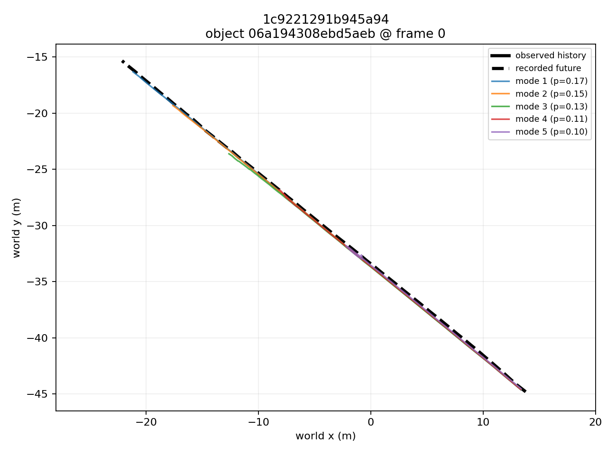
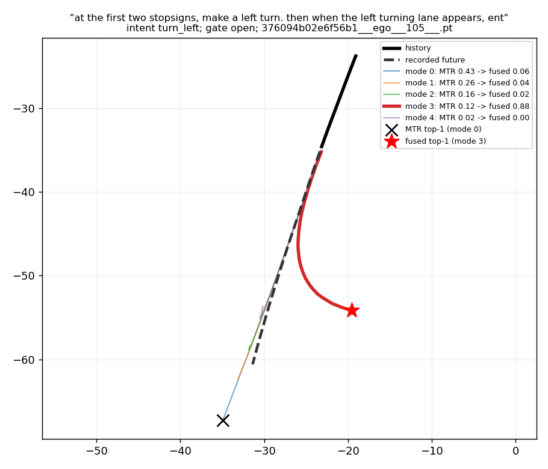

# Language-Guided Planning for Self-Driving Cars

Motion forecasting with MTR on nuPlan driving logs, and re-ranking of the predicted ego
trajectories with the passenger instructions of the doPlan dataset.

UCSD ECE 191 team project, Fall 2026. Team: Hyungjun Doh and Yushan Xian (lead).
Advisor: Prof. Mohan Trivedi. This repository holds the forecasting pipeline and the language
re-ranking module. Everything in it was built and verified on one machine: Windows with WSL2 and
Docker Desktop, NVIDIA RTX 5070 Ti.

1. [What the system does](#1-what-the-system-does)
2. [Modules](#2-modules)
3. [Repository layout](#3-repository-layout)
4. [Results so far](#4-results-so-far)
5. [Reproducing the pipeline](#5-reproducing-the-pipeline)
6. [Documentation, and what is not in the repository](#6-documentation-and-what-is-not-in-the-repository)
7. [Notes and references](#7-notes-and-references)

## 1. What the system does

A passenger says "make a left turn at the next stop sign". A motion forecaster already predicts
several plausible futures for the ego vehicle, each with a probability. This project asks whether
the instruction can pick the right one.

The forecaster is MTR (Motion Transformer) as packaged by Valeo4Cast / UniTraj, pretrained and
not retrained here. It takes 2 s of history (21 states at 10 Hz) plus the map and predicts
5 candidate trajectories ("modes") over the next 6 s (60 states), each with a score. The language
side turns an instruction into an intent distribution and re-scores the 5 modes.

```
nuPlan .db logs + city maps ──► nuplan-convert (CPU image) ──► ScenarioNet .pkl
                                                                     │
                                                                     ▼
                                                      mtr (GPU image): pretrained MTR
                                                                     │
                                                       5 ego modes with MTR scores
                                                                     │
doPlan instructions ──► word2vec ──► intent classifier ──► P(intent) ─┤
(text + time windows)                 turn_left / turn_right /        │
                                      lane_left / lane_right /        ▼
                                      stop / straight / other   doplan_lang (host Python):
                                                                align, gate, re-rank, evaluate
```

Three ideas carry the re-ranking:

- **Intent from text.** Skip-gram word2vec (100 dimensions) is trained on the doPlan instruction
  corpus. A logistic-regression classifier on mean word vectors maps a clause to one of seven
  intents. Labels come from keyword rules (weak supervision); the six evaluation logs are held out
  of training.
- **Geometric compatibility.** Each MTR mode is described in the ego frame by its endpoint
  lateral offset, heading change and path length. A compatibility table turns those into how well
  the mode fits each intent.
- **Decision-point gating.** The fused score is `softmax(log s_MTR + lambda * log c_intent)`,
  applied only where the plausible modes actually fork (endpoint spread over 4 m or heading spread
  over 20 degrees). Elsewhere MTR's ranking is kept. The gate exists because doPlan instructions
  refer to manoeuvres that start a median 24.6 s after they are spoken, far beyond MTR's 6 s
  horizon.

## 2. Modules

### Software

| Module | Where | What it does |
|---|---|---|
| CUDA / PyTorch base image | `Dockerfile` (target `gpu`) | CUDA 12.8.1 + PyTorch 2.7.1 built for Blackwell (`sm_120`). `scripts/gpu_smoke.py` proves GPU access. |
| MTR image | `Dockerfile` (target `mtr`) | Valeo4Cast at a pinned commit with its KNN and attention CUDA extensions compiled for PyTorch 2.7. `scripts/patch_valeo4cast_for_nuplan.py` adds the nuPlan map types. |
| nuPlan converter image | `Dockerfile.nuplan`, `scripts/convert_nuplan.sh`, `scripts/patch_nuplan_convert.py` | nuplan-devkit (Python 3.9) plus the ScenarioNet converter, patched to work with one city map and short logs. |
| Data fetcher | `scripts/fetch_nuplan_toy.py` | Pulls single logs and maps out of the official nuPlan archives with HTTP range requests, so the 8.5 GB mini split is never downloaded whole. |
| Inference and inspection | `scripts/run_inference.sh`, `scripts/toy_nuscenes.sh`, `scripts/inspect_io.py`, `scripts/plot_prediction.py`, `scripts/check_checkpoint.py`, `scripts/check_ops.py` | Run the pretrained model, verify the checkpoint and the CUDA ops, report every input and output tensor, plot forecasts. |
| Language re-ranking | `scripts/doplan_lang/` | The doPlan side: text, word2vec, intent classifier, alignment, geometry, gate and fusion, metrics (table below). |
| Tests | `scripts/doplan_lang/tests/` | 97 pytest tests: unit tests per module plus an end-to-end synthetic run. |

`scripts/doplan_lang/`, in pipeline order:

| File | Role |
|---|---|
| `text.py` | Instruction normalisation, tokens, clause splitting, keyword intent rules (weak labels). |
| `train_word2vec.py` | Trains gensim skip-gram word2vec on doPlan text; writes `word2vec.kv` and a report. |
| `intent.py` | Mean-word2vec clause vectors and the logistic-regression intent classifier; 5-fold CV report. |
| `align.py` | Puts doPlan time windows and MTR predictions on the same nuPlan log clock (verified to 3 mm). |
| `geometry.py` | Per-mode ego-frame features (lateral offset, heading change, length) and intent compatibility. |
| `rerank.py` | Decision-point gate and log-linear fusion of MTR scores with compatibility. |
| `evaluate.py` | Top-1 ADE/FDE, minADE, directional compliance, counterfactual consistency, cluster-bootstrap CIs, example plots. |
| `run_all.py` | One command for the whole chain on a ScenarioNet database. |
| `embedding_space.py` | Probe of the learned embedding space (left/right axis, representative commands). |
| `config.py` | Every tunable number and name in one place. |

### Hardware and environment

- NVIDIA RTX 5070 Ti (Blackwell, compute capability 12.0). Needs CUDA 12.8 and PyTorch 2.7.1
  (cu128); the CUDA 11.8 wheels the upstream code targets do not support it.
- Windows host with WSL2 (Ubuntu) and Docker Desktop with GPU passthrough. Only the Windows NVIDIA
  driver lives on the host; all CUDA libraries are inside the images.
- The converter runs on the CPU: the six evaluation logs convert in about 1.5 min with four
  workers. MTR inference on them takes about 50 min on the GPU (12,688 ego predictions, 222k
  predictions in total).
- The language module runs on the host in plain Python (gensim 4.4, scikit-learn 1.7). It needs
  torch only to read the prediction files.

## 3. Repository layout

```
.
├── Dockerfile               # gpu and mtr image targets
├── Dockerfile.nuplan        # nuplan-convert image
├── compose.yaml             # services: nuplan-convert, gpu, mtr (mounts come from .env)
├── .env.example             # host paths for weights, data and outputs (copy to .env)
├── scripts/                 # everything the images run, plus host-side tools
│   ├── doplan_lang/         # language re-ranking package (+ tests/)
│   └── ...
├── docs/superpowers/
│   ├── specs/...-design.md  # design document for the re-ranking (sections 1 to 9)
│   └── plans/...-rerank.md  # implementation plan with execution notes per task
└── outputs/                 # committed: metrics, reports and figures (bulk files are ignored)
    ├── doplan_lang/         # main run (lambda = 1) with plots/ and embedding_space/
    ├── doplan_lang_lam*/    # lambda sweep (0.5, 2, 4): metrics only
    └── *_io_report.txt, *.png   # MTR input/output reports and forecast plots on the toy logs
```

Not in the repository because of size: `weights/`, `nuplan_data/`, `scenarionet_data/`, `logs/`
and the bulky parts of `outputs/`. Section 6 says how to regenerate each one.

## 4. Results so far

### Forecasting pipeline (verified 2026-10-17)

All three images build and run. The pretrained checkpoint loads with zero missing or mismatched
tensors. On one Pittsburgh mini-split log, converted by `nuplan-convert` and predicted by `mtr`,
the first two scenarios yield 1049 prediction files covering 59 agents (vehicles, pedestrians and
one cyclist) at up to 29 prediction times each. Median minADE against the recorded futures is
about 0.5 m.



*One agent on the Pittsburgh log: observed history, recorded future (dashed) and MTR's five modes
with their probabilities.*

### Language re-ranking (run of 2026-10-24)

Data: six doPlan-annotated nuPlan mini logs (three Singapore, three Pittsburgh), 411 scenarios,
12,688 ego predictions, 90 instructions, 77,127 (instruction, prediction) pairs. The alignment
check passed on all 411 scenarios within 3 mm. The gate is open on 82.5% of pairs. Headline
numbers are over gated pairs (63,621 pairs at 2,835 distinct moments); confidence intervals
resample moments. Compliance is measured on the 13,952 pairs whose rule-labelled instruction is
lateral and whose recorded 6 s endpoint moved at least 1 m to that side.

| lambda | top-1 ADE before | after | ADE diff 95% CI | minADE | compliance before | after | compliance diff 95% CI | counterfactual |
|---|---|---|---|---|---|---|---|---|
| 0.5 | 1.694 | 1.788 | [-0.008, +0.224] | 0.674 | 0.695 | 0.778 | [+0.045, +0.135] | 0.080 |
| 1.0 | 1.694 | 1.890 | [+0.069, +0.350] | 0.674 | 0.695 | 0.824 | [+0.080, +0.190] | 0.120 |
| 2.0 | 1.694 | 1.973 | [+0.133, +0.452] | 0.674 | 0.695 | 0.839 | [+0.092, +0.205] | 0.153 |
| 4.0 | 1.694 | 2.072 | [+0.217, +0.552] | 0.674 | 0.695 | 0.848 | [+0.097, +0.221] | 0.165 |

How to read it:

- Re-ranking makes the chosen mode follow the instructed direction more often (compliance +0.13
  at lambda 1) but moves it away from what the driver actually did (top-1 ADE +0.20 m). Both
  effects grow with lambda.
- At lambda 1 the top-1 mode changes on 14% of gated pairs. When it changes, the new mode heads
  toward the instructed side 87% of the time, yet in 47% of those moments the recorded driver was
  still going straight: the instructed turn lies later in its 30 to 500 s window. This is the
  temporal mismatch the doPlan paper reports (median 24.6 s).
- The word2vec classifier and the rules-only ablation are indistinguishable (they disagree on
  2.2% of pairs). In the embedding space `left` and `right` are each other's nearest neighbour
  (cosine 0.59). Direction is a low-variance keyword axis that the classifier still reads
  reliably: swapping left and right flips its prediction in 92.6% of turn clauses. Details in
  `outputs/doplan_lang/embedding_space/embedding_space.md`.
- 58% of the pairs come from one Singapore log with 57 annotations. Counterfactual consistency
  is low (0.12) because MTR rarely offers a mode on the opposite side.



*A typical case. The instruction says "make a left turn"; the gate is open, and fusion moves the
top-1 from MTR's straight mode (score 0.43) to the left-turn mode (0.12 to 0.88). The recorded
future (dashed) continues straight: the turn comes later in the instruction's window.*

Next step: stage tracking, which applies an instruction only once the event it refers to (the
stop sign, the light) is near. See section 9 of the design document.

## 5. Reproducing the pipeline

### 5.0 Prerequisites (Windows + WSL2)

1. Install and start [Docker Desktop for Windows](https://docs.docker.com/desktop/features/gpu/).
2. Docker Desktop > Settings > General: enable **Use the WSL 2 based engine**.
3. Docker Desktop > Settings > Resources > WSL Integration: enable your Ubuntu distro.
4. From your WSL Ubuntu shell: `docker version && docker compose version`.
   Docker Compose **2.30 or newer** is required for `gpus: all`.
5. Confirm GPU access before building anything:

   ```bash
   docker run --rm --gpus all nvidia/cuda:12.8.1-base-ubuntu22.04 nvidia-smi
   ```

You do not need `nvcc` or PyTorch on the host. The NVIDIA display driver stays on Windows.

### 5.1 Clone and build the GPU image

```bash
git clone <this repository> ~/projects/valeo_mtr_docker
cd ~/projects/valeo_mtr_docker
cp .env.example .env
mkdir -p weights scenarionet_data outputs nuplan_data

docker compose build gpu
docker compose run --rm gpu
```

Expected: the GPU name, `CUDA True`, capability `(12, 0)` and
`SUCCESS: CUDA matrix multiply executed on the GPU.` If this fails, fix Docker Desktop's WSL 2
integration, not the MTR code.

### 5.2 Build the MTR image

```bash
docker compose build mtr
```

This fetches Valeo4Cast at commit `dce207347c140ed5cdaeac6c217eb00ee0634e71`, installs its
Python packages, applies the nuPlan loader patch and compiles its KNN and attention CUDA
extensions for `TORCH_CUDA_ARCH_LIST=12.0`. If compilation fails, keep the build log and fix the
indicated C++/CUDA API rather than downgrading PyTorch to the original CUDA 11.8 wheel, which does
not support `sm_120`.

### 5.3 Weights and data

Download `pretrained_weights.zip` from
https://drive.google.com/drive/folders/1qzHdi6wIexiyrF03pZHPzz5h1LssqeX4 and extract it into
`./weights/` (it contains `checkpoint_for_val_test.ckpt`). Alternatively set `HOST_WEIGHTS_DIR`
in `.env` to an absolute WSL path that holds the extracted checkpoint.

`.env` holds the host paths the containers mount (defaults shown):

```
HOST_WEIGHTS_DIR=./weights
HOST_SCENARIONET_DIR=./scenarionet_data
HOST_RESULTS_DIR=./outputs
HOST_NUPLAN_DIR=./nuplan_data      # raw nuPlan logs and maps for the converter
```

`run_inference.sh` reads `$SCENARIONET_DIR` (default `/mnt/scenarionet`), so several ScenarioNet
databases can live side by side under that mount.

### 5.4 Check the checkpoint

```bash
docker compose run --rm mtr bash -lc '  CKPT=$(find /mnt/weights -name checkpoint_for_val_test.ckpt -print -quit);   test -n "$CKPT" || { echo "checkpoint not found" >&2; exit 2; };   python3 /opt/mtr-scripts/check_checkpoint.py "$CKPT" --compare-model'
```

Missing keys, unexpected keys and shape mismatches must all be zero. If loading fails on
trusted Lightning metadata and you trust the file, the script accepts `--unsafe-trusted-file`.

### 5.5 Run inference

```bash
docker compose run --rm mtr bash /opt/mtr-scripts/run_inference.sh
```

Predictions land in `<HOST_SCENARIONET_DIR>/output_MTR/*.pt`. `run_inference.sh` caps the run at
`debug_max_nb_scenarios=2`; extra arguments go to Hydra, for example
`bash /opt/mtr-scripts/run_inference.sh debug_max_nb_scenarios=100`.

Without any nuPlan data, `bash /opt/mtr-scripts/toy_nuscenes.sh` runs the same path on the
nuScenes samples bundled with Valeo4Cast and writes `outputs/toy_io_report.txt` (every model
input and output field with its shape) plus `outputs/toy_forecast.png`.

To open a shell in the container:

```bash
docker compose run --rm mtr bash
# inside: nvidia-smi ; python3 /opt/mtr-scripts/gpu_smoke.py
```

### 5.6 nuPlan: convert one log and predict on it

nuPlan logs are `.db` SQLite files, one per drive, plus one GeoPackage map per city.
`scripts/fetch_nuplan_toy.py` reads single members out of the official archives with HTTP range
requests:

```bash
python3 scripts/fetch_nuplan_toy.py --dest nuplan_data --list      # all 64 mini logs by size
python3 scripts/fetch_nuplan_toy.py --dest nuplan_data \
    --log 2021.08.24.13.12.55_veh-45_00386_00472 --city us-pa-pittsburgh-hazelwood
```

That transfers 149 MB (an 11 MB log and the 187 MB Pittsburgh map, compressed) into the layout
nuplan-devkit expects under `nuplan_data/` and verifies the log with SQLite. The data is
CC BY-NC-SA 4.0 plus Motional's additional terms; the LICENSE is written next to it.

Convert on the CPU, then run the pretrained model on the result:

```bash
docker compose build nuplan-convert
docker compose run --rm nuplan-convert           # -> scenarionet_data/nuplan_toy/
docker compose run --rm -e SCENARIONET_DIR=/mnt/scenarionet/nuplan_toy \
    mtr bash /opt/mtr-scripts/run_inference.sh   # -> scenarionet_data/nuplan_toy/output_MTR/
docker compose run --rm -e SCENARIONET_DIR=/mnt/scenarionet/nuplan_toy mtr bash -lc \
    'python3 /opt/mtr-scripts/inspect_io.py --cache $SCENARIONET_DIR/cache_test_MTR \
       --outputs $SCENARIONET_DIR/output_MTR --plot /mnt/outputs/nuplan_toy_forecast.png'
```

Every log under the converter's input split is converted together. `NUM_WORKERS`,
`NUPLAN_RAW_DIR` and `SCENARIONET_OUT` can be passed with `-e`.

What `Dockerfile.nuplan` works around (patches live in `scripts/patch_nuplan_convert.py`):

- nuplan-devkit pins Python 3.9 and torch 1.9, so conversion cannot share the `mtr` image.
- The devkit's map loader opens all four city maps at start-up. The patch skips cities whose
  `map.gpkg` is not on disk, so one city's map is enough.
- The vendored converter dropped every scenario without a mission goal. It never uses the goal,
  and short mini-split logs have none, so that filter now defaults off
  (`NUPLAN_REMOVE_INVALID_GOALS=true` restores upstream behaviour).
- The converter emits two map types that no metadrive release defines, so metadrive is installed
  from a pinned git commit. On the reader side, `scripts/patch_valeo4cast_for_nuplan.py` maps
  them for UniTraj: lanes through intersections count as lanes, sidewalk polygons are skipped.

### 5.7 doPlan language re-ranking

Host-side Python, no Docker needed for the language part:

```bash
python3 -m pip install -r scripts/requirements-doplan.txt
PYTHONPATH=scripts python3 -m pytest scripts/doplan_lang/tests -q        # 97 tests
```

Fetch the doPlan annotations and the six evaluation logs with their two city maps, then expose
the six logs to the converter as their own split:

```bash
mkdir -p nuplan_data/doplan
curl -sSL -o nuplan_data/doplan/release_annotationsV1.csv \
  https://raw.githubusercontent.com/Mi3-Lab/doPlan/main/outputs/doPlan_submissions/release_annotationsV1.csv

python3 scripts/fetch_nuplan_toy.py --dest nuplan_data \
  --log 2021.10.11.02.57.41_veh-50_00352_00535 \
  --log 2021.10.11.08.31.07_veh-50_01750_01948 \
  --log 2021.10.11.02.57.41_veh-50_01522_02088 \
  --log 2021.08.17.18.54.02_veh-45_00665_01065 \
  --log 2021.08.17.17.17.01_veh-45_02314_02798 \
  --log 2021.08.17.16.57.11_veh-08_01200_01636 \
  --city sg-one-north --city us-pa-pittsburgh-hazelwood

mkdir -p nuplan_data/nuplan-v1.1/splits/doplan
for l in 2021.10.11.02.57.41_veh-50_00352_00535 2021.10.11.08.31.07_veh-50_01750_01948 \
         2021.10.11.02.57.41_veh-50_01522_02088 2021.08.17.18.54.02_veh-45_00665_01065 \
         2021.08.17.17.17.01_veh-45_02314_02798 2021.08.17.16.57.11_veh-08_01200_01636; do
  ln -f nuplan_data/nuplan-v1.1/splits/mini/$l.db nuplan_data/nuplan-v1.1/splits/doplan/$l.db
done
```

Convert and predict with the Docker services, then run the language chain:

```bash
docker compose run --rm -e NUPLAN_RAW_DIR=/mnt/nuplan/nuplan-v1.1/splits/doplan \
    -e SCENARIONET_OUT=/mnt/scenarionet/nuplan_doplan -e NUM_WORKERS=4 nuplan-convert
docker compose run --rm -e SCENARIONET_DIR=/mnt/scenarionet/nuplan_doplan \
    mtr bash /opt/mtr-scripts/run_inference.sh debug_max_nb_scenarios=100000

PYTHONPATH=scripts python3 -m doplan_lang.run_all --scenarionet scenarionet_data/nuplan_doplan \
  --nuplan nuplan_data --csv nuplan_data/doplan/release_annotationsV1.csv --out outputs/doplan_lang
```

`run_all.py` accepts `--lam` for the sweep and `--no-pt` to skip writing the 910 MB of
re-scored prediction files. The embedding-space probe is a separate command:

```bash
PYTHONPATH=scripts python3 -m doplan_lang.embedding_space \
  --csv nuplan_data/doplan/release_annotationsV1.csv \
  --kv outputs/doplan_lang/word2vec.kv --clf outputs/doplan_lang/intent_clf.joblib \
  --out-dir outputs/doplan_lang/embedding_space
```

Outputs in `outputs/doplan_lang/`: `word2vec.kv` and `word2vec_report.md` (616 words),
`intent_clf.joblib` and `intent_report.md` (0.957 cross-validated agreement with the keyword
rules), `pairs.csv`, `coverage.csv`, `reranked.csv` (per pair: intent probabilities, gate,
per-mode features, MTR and fused scores, errors), `reranked_rules.csv` (rules-only ablation),
`reranked_pt/` (predictions with fused scores), `metrics.json`, `metrics.md`, `plots/`.

## 6. Documentation, and what is not in the repository

Documents in this repository:

- `docs/superpowers/specs/2026-10-23-doplan-word2vec-mtr-rerank-design.md`: the design of the
  re-ranking (data, alignment rule, intent model, compatibility, gate, metrics, open questions).
- `docs/superpowers/plans/2026-10-23-doplan-word2vec-mtr-rerank.md`: the implementation plan,
  task by task, with notes on what was learned while executing each task.
- `outputs/doplan_lang/metrics.md`: the full results tables for the main run, with the
  rules-only ablation and the "classifier disagrees with the rules" subset.
- `outputs/doplan_lang_lam*/metrics.md`: the same tables for lambda 0.5, 2 and 4.
- `outputs/doplan_lang/embedding_space/embedding_space.md`: the embedding-space probe.
- `outputs/doplan_lang/intent_report.md`, `outputs/doplan_lang/word2vec_report.md`: classifier
  confusion matrix and nearest neighbours of key words.
- `outputs/*_io_report.txt`: every tensor MTR reads and writes, with shapes, on the toy logs.

Large files that are ignored by git, with their size on the development machine and how to get
them back:

| Path | Size | How to regenerate |
|---|---|---|
| `weights/` | 2.8 GB | Download from the Google Drive link in 5.3. |
| `nuplan_data/` | 0.8 GB | `scripts/fetch_nuplan_toy.py` (5.6, 5.7) and the doPlan CSV download (5.7). |
| `scenarionet_data/` | 4.2 GB | `nuplan-convert` then `mtr` inference (5.6, 5.7). |
| `outputs/**/reranked_pt/`, `pairs.csv`, `reranked*.csv` | 1.8 GB | `doplan_lang.run_all` (5.7). |
| `logs/` | 5 MB | Build and run logs; recreated by running the steps. |

## 7. Notes and references

- The model is Valeo4Cast's **UniTraj MTR**, not the original `sshaoshuai/MTR`. The pinned
  config uses 21 past states, 60 future states at 10 Hz and 5 predicted modes.
- The `mtr` image includes `scenarionet` only for reading converted scenarios. Raw `.db`
  conversion runs in the separate `nuplan-convert` image because the devkit's pins conflict
  with modern PyTorch.
- nuPlan's `ego_pose` is the rear axle while ScenarioNet positions are the vehicle centre
  (1.461 m ahead on the Pacifica). The alignment compares centres; comparing the two frames
  directly mismatches lane changes by up to 1.5 m.
- Converter scenarios overlap heavily, so each pair carries a 0.5 s "moment" key and all
  confidence intervals are cluster-bootstrapped by moment.
- A rerun of MTR inference rebuilds the UniTraj cache (`cache_test_MTR`, about 184 GB for the six
  logs, roughly 15 min) and refuses to start while `output_MTR` is non-empty.
- Helper scripts not mentioned above: `subset_scenarionet.py` (cut a small ScenarioNet
  database), `plot_prob_modes.py`, `modernize_cuda_cpp.py` (minimal pointer-API update for the
  CUDA extensions), `diag_unitraj.sh`.

References:

- Valeo4Cast: https://github.com/valeoai/valeo4cast
- doPlan: https://github.com/Mi3-Lab/doPlan
- nuPlan: https://www.nuscenes.org/nuplan
- Docker Desktop GPU support: https://docs.docker.com/desktop/features/gpu/
- Compose `gpus`: https://docs.docker.com/reference/compose-file/services/#gpus
- PyTorch previous versions: https://pytorch.org/get-started/previous-versions/
- NVIDIA CUDA images: https://hub.docker.com/r/nvidia/cuda/tags?name=12.8.1-cudnn-devel-ubuntu22.04
