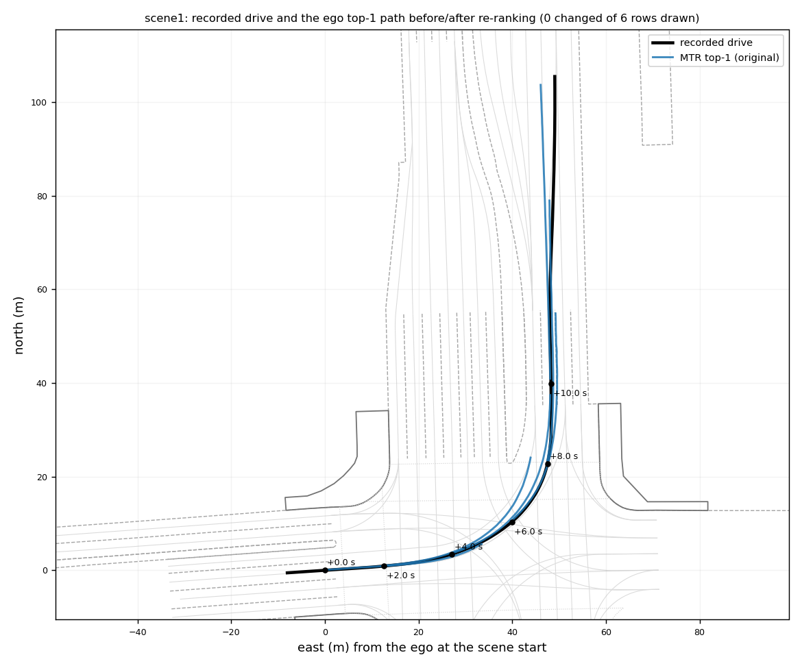
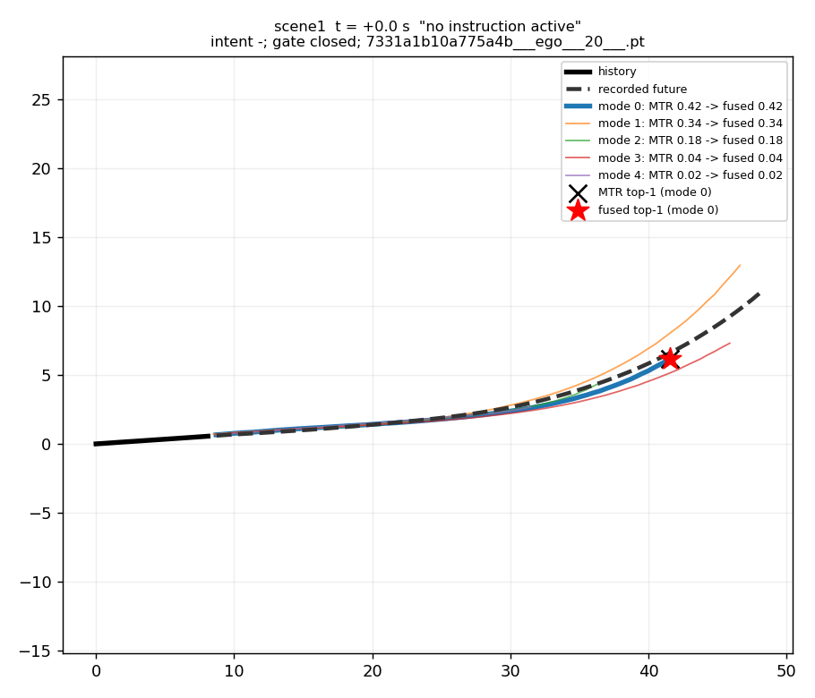
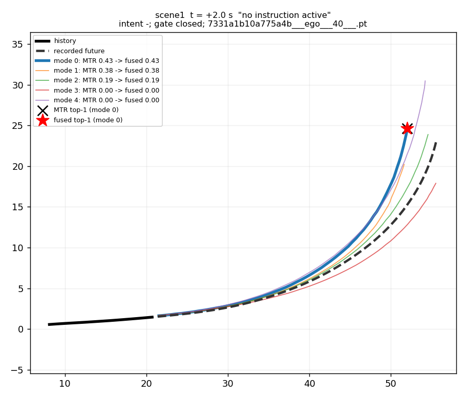
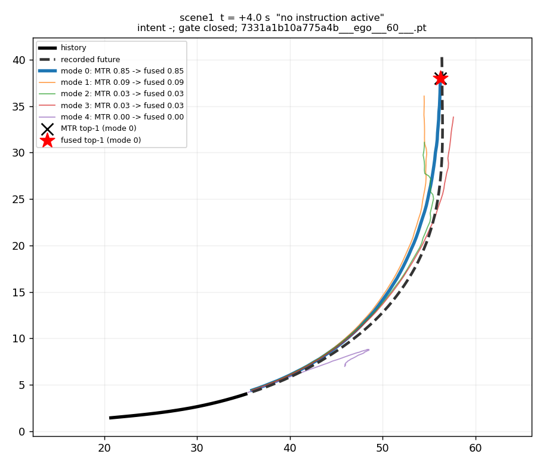
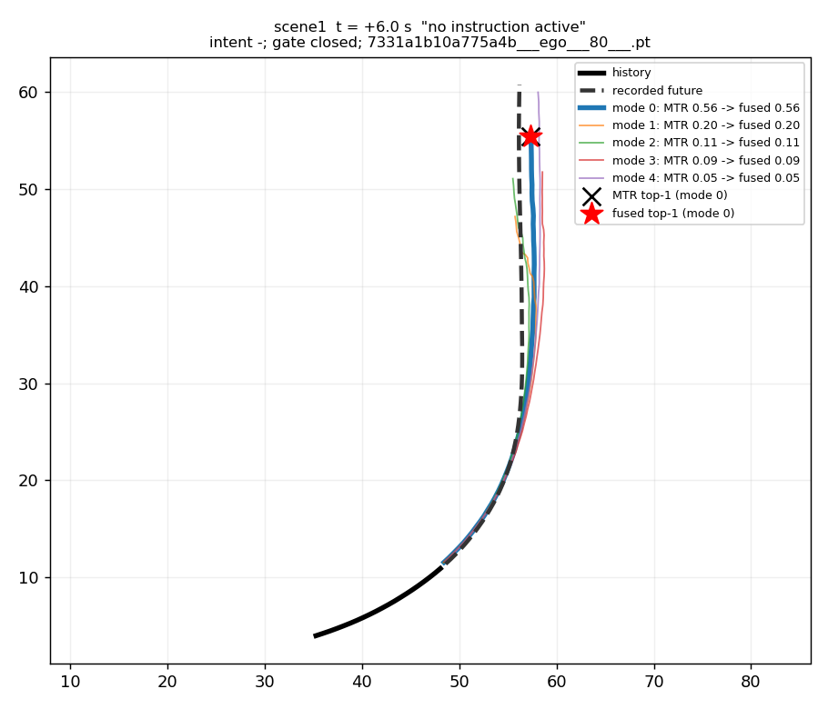
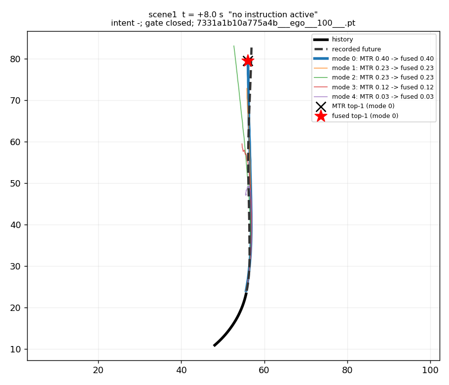
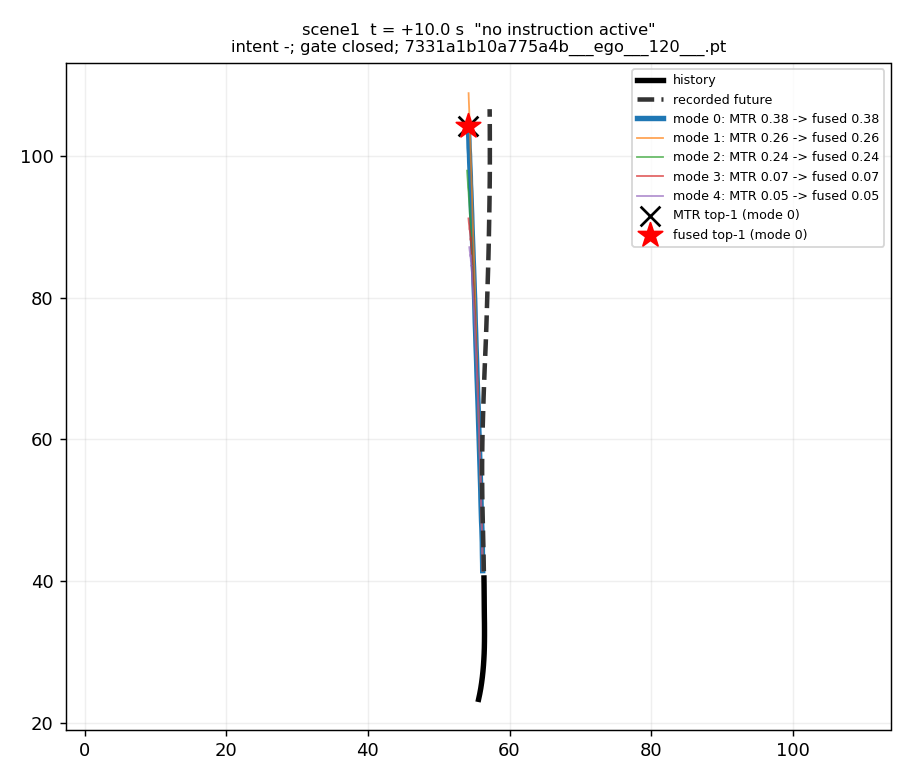

# scene1

- clip: `2021.06.09.12.39.51_veh-26_05332_05540`
- start timestamp: 1623262378149565 us = 25.10 s after the first lidar frame of the log (doPlan frame 125.5)
- moments found: 21 (every 0.5 s); max |dt| to the nominal moment 0 ms

## Instructions whose window covers the scene start

(none: MTR scores are reported unchanged)

## Original vs re-ranked top-1 path

Re-ranking left the top-1 unchanged on all 21 rows (21 moments); the original path is the path.

## Moments

| t (s) | annotation | intent | gate | MTR scores | fused scores | top-1 MTR -> fused | labels MTR top-1 / fused / recorded | ADE top-1 MTR / fused (m) | minADE |
|---|---|---|---|---|---|---|---|---|---|
| 0.0 | - | - | closed | 0.42 0.34 0.18 0.04 0.02 | 0.42 0.34 0.18 0.04 0.02 | 0 -> 0 | straight / straight / turn_left | 2.34 / 2.34 | 0.90 |
| 0.5 | - | - | closed | 0.81 0.14 0.02 0.01 0.01 | 0.81 0.14 0.02 0.01 0.01 | 0 -> 0 | turn_left / turn_left / turn_left | 0.93 / 0.93 | 0.93 |
| 1.0 | - | - | closed | 0.84 0.07 0.06 0.02 0.00 | 0.84 0.07 0.06 0.02 0.00 | 0 -> 0 | - / - / - | 1.76 / 1.76 | 0.87 |
| 1.5 | - | - | closed | 0.55 0.36 0.06 0.02 0.00 | 0.55 0.36 0.06 0.02 0.00 | 0 -> 0 | - / - / - | 2.08 / 2.08 | 0.91 |
| 2.0 | - | - | closed | 0.43 0.38 0.19 0.00 0.00 | 0.43 0.38 0.19 0.00 0.00 | 0 -> 0 | - / - / - | 1.44 / 1.44 | 0.61 |
| 2.5 | - | - | closed | 0.47 0.44 0.08 0.00 0.00 | 0.47 0.44 0.08 0.00 0.00 | 0 -> 0 | - / - / - | 0.70 / 0.70 | 0.69 |
| 3.0 | - | - | closed | 0.82 0.12 0.05 0.01 0.00 | 0.82 0.12 0.05 0.01 0.00 | 0 -> 0 | - / - / - | 1.33 / 1.33 | 0.85 |
| 3.5 | - | - | closed | 0.77 0.21 0.01 0.01 0.00 | 0.77 0.21 0.01 0.01 0.00 | 0 -> 0 | turn_left / turn_left / turn_left | 1.25 / 1.25 | 1.25 |
| 4.0 | - | - | closed | 0.85 0.09 0.03 0.03 0.00 | 0.85 0.09 0.03 0.03 0.00 | 0 -> 0 | turn_left / turn_left / turn_left | 0.90 / 0.90 | 0.90 |
| 4.5 | - | - | closed | 0.69 0.15 0.12 0.04 0.00 | 0.69 0.15 0.12 0.04 0.00 | 0 -> 0 | turn_left / turn_left / turn_left | 0.95 / 0.95 | 0.95 |
| 5.0 | - | - | closed | 0.53 0.23 0.12 0.11 0.00 | 0.53 0.23 0.12 0.11 0.00 | 0 -> 0 | turn_left / turn_left / turn_left | 1.09 / 1.09 | 1.09 |
| 5.5 | - | - | closed | 0.52 0.24 0.14 0.09 0.01 | 0.52 0.24 0.14 0.09 0.01 | 0 -> 0 | turn_left / turn_left / turn_left | 1.47 / 1.47 | 1.19 |
| 6.0 | - | - | closed | 0.56 0.20 0.11 0.09 0.05 | 0.56 0.20 0.11 0.09 0.05 | 0 -> 0 | turn_left / turn_left / turn_left | 1.67 / 1.67 | 1.11 |
| 6.5 | - | - | closed | 0.41 0.23 0.22 0.09 0.06 | 0.41 0.23 0.22 0.09 0.06 | 0 -> 0 | turn_left / turn_left / turn_left | 1.69 / 1.69 | 1.14 |
| 7.0 | - | - | closed | 0.34 0.28 0.15 0.13 0.11 | 0.34 0.28 0.15 0.13 0.11 | 0 -> 0 | turn_left / turn_left / straight | 2.17 / 2.17 | 1.03 |
| 7.5 | - | - | closed | 0.53 0.20 0.15 0.06 0.05 | 0.53 0.20 0.15 0.06 0.05 | 0 -> 0 | straight / straight / straight | 0.69 / 0.69 | 0.69 |
| 8.0 | - | - | closed | 0.40 0.23 0.23 0.12 0.03 | 0.40 0.23 0.23 0.12 0.03 | 0 -> 0 | straight / straight / straight | 1.70 / 1.70 | 1.40 |
| 8.5 | - | - | closed | 0.51 0.33 0.06 0.05 0.05 | 0.51 0.33 0.06 0.05 0.05 | 0 -> 0 | straight / straight / straight | 0.99 / 0.99 | 0.99 |
| 9.0 | - | - | closed | 0.50 0.35 0.07 0.05 0.03 | 0.50 0.35 0.07 0.05 0.03 | 0 -> 0 | straight / straight / straight | 1.00 / 1.00 | 1.00 |
| 9.5 | - | - | closed | 0.41 0.29 0.12 0.12 0.06 | 0.41 0.29 0.12 0.12 0.06 | 0 -> 0 | lane_left / lane_left / straight | 1.24 / 1.24 | 1.24 |
| 10.0 | - | - | closed | 0.38 0.26 0.24 0.07 0.05 | 0.38 0.26 0.24 0.07 0.05 | 0 -> 0 | straight / straight / straight | 1.51 / 1.51 | 1.51 |

## Plots

